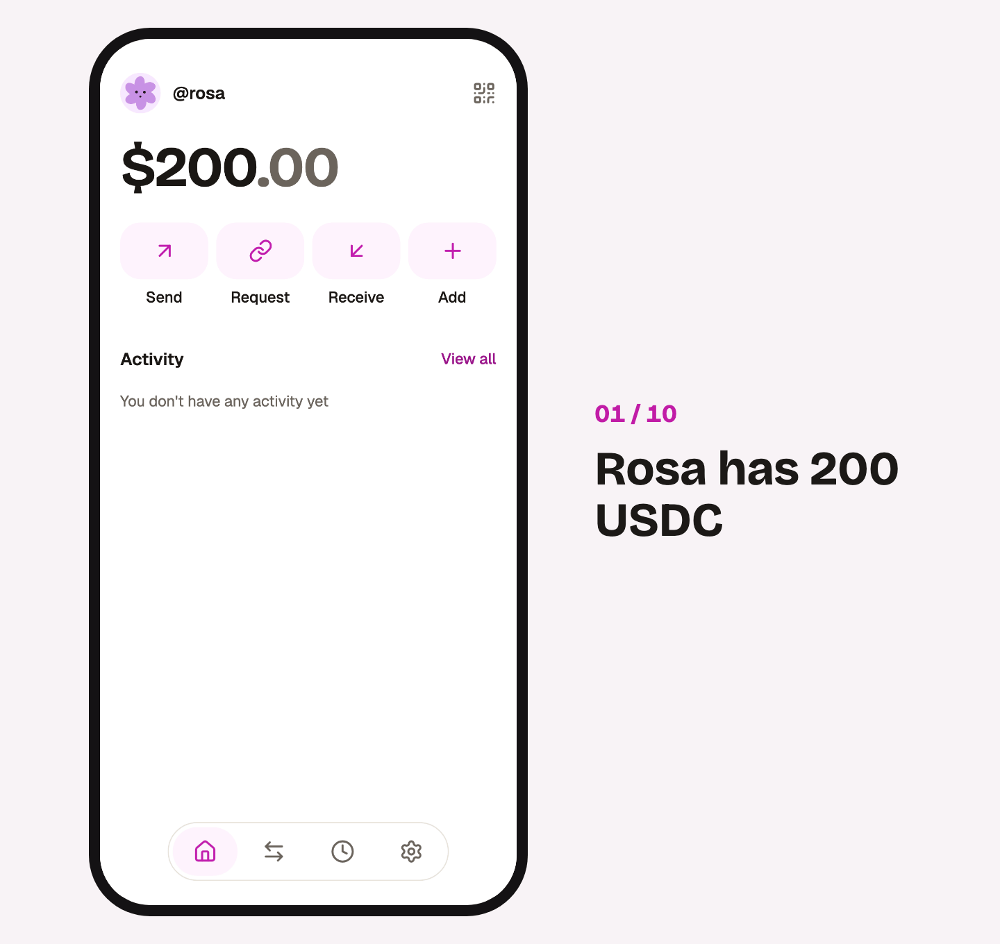
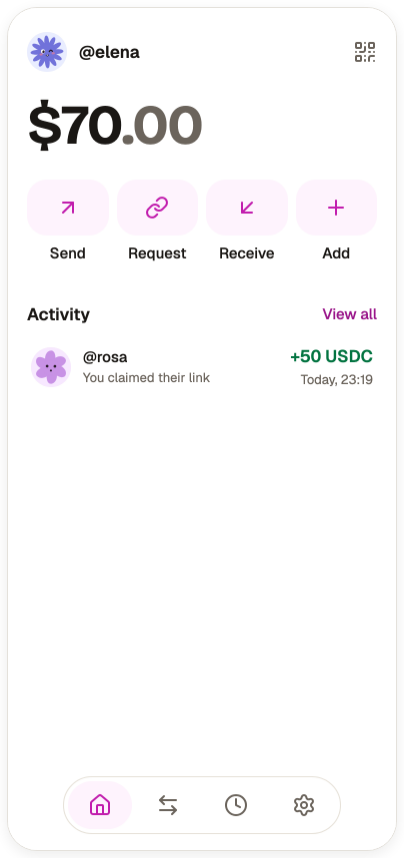

<p align="center">
  <picture>
    <source media="(prefers-color-scheme: dark)" srcset="docs/assets/orchid-logo-dark.png" />
    
  </picture>
</p>

<h3 align="center">Dollars that move by link.</h3>

<p align="center">
  Self-custodial USDC wallet on Solana devnet for Latin America, starting in Peru.<br />
  Built for the dev3pack Solana hackathon · English &amp; Spanish
</p>

<p align="center">
  
</p>

## Why Orchid

- **Every payment link is a new-user channel.** Send USDC in a chat message. The `orchid-links` Anchor program holds the unclaimed funds on Solana while the claim key stays in the URL `#fragment` (never sent to the server). A recipient with no wallet opens the link and claims straight into a new passkey-backed wallet in two taps, with fees and token-account rent sponsored. The sender can reclaim unclaimed funds at any time; whichever of claim or reclaim lands first wins.
- **Cash out to your local wallet from the same link.** Recipients who want local currency instead of a wallet tap **Local wallet** on the exact same payment link and pick the wallet they already use — Yape in Peru, PIX in Brazil, Nequi in Colombia, Mercado Pago across LatAm (quoted in Mexican pesos on devnet) — enter their phone number, PIX key or email, review the local-currency quote, and track settlement. _(On devnet this uses a simulated payout partner — no real money is paid out; live payouts require a licensed partner.)_
- **Request links payable from any Solana wallet.** Share a public `/pay/<id>` link for an exact USDC amount and optional note. Payers settle in Orchid or from an external Solana wallet such as Phantom or Solflare via Solana Pay and Blinks (the external payer covers the network fee).

## Mobile screens

<table>
  <tr>
    <td align="center" width="25%">
      
      <br />
      <sub><strong>Payment link</strong><br />Claim in Orchid, a local wallet, or another wallet</sub>
    </td>
    <td align="center" width="25%">
      
      <br />
      <sub><strong>Local wallet cash-out (sim)</strong><br />Yape, PIX, Nequi or Mercado Pago</sub>
    </td>
    <td align="center" width="25%">
      
      <br />
      <sub><strong>Payment request</strong><br />Solana Pay QR, Blinks, or Orchid</sub>
    </td>
    <td align="center" width="25%">
      
      <br />
      <sub><strong>Passkey wallet</strong><br />Self-custodial USDC &amp; activity</sub>
    </td>
  </tr>
</table>

## Built with

Solana, SPL Token, Anchor (`orchid-links`), Solana Pay & Blinks, WebAuthn PRF passkeys, TanStack Start, React, Effect, Drizzle, Postgres, Cloudflare Workers & Hyperdrive, Bun, and Tailwind CSS.

## Run it locally

Install Bun and Node.js 22.12+, and start Docker. Have a Solana devnet RPC URL ready for the setup prompt (or set `SOLANA_RPC_URL` beforehand).

```sh
bun run setup
bun run dev
```

Open [localhost:3000](http://localhost:3000).

Setup installs dependencies, starts the local Postgres container `orchid-postgres` on port `55432`, applies migrations, and configures the gitignored `apps/web/.dev.vars`. Rerun setup safely at any time to preserve existing values or reuse the main checkout's config in a worktree.

Setup creates a devnet sponsor if needed and attempts a SOL airdrop. If the airdrop fails, fund the printed public sponsor address at the [Solana faucet](https://faucet.solana.com) and rerun setup to open the simulated payout partner's USDC token account.

### Browser tests

With Docker, Surfpool, and the Anchor toolchain installed:

```sh
bun run setup --e2e
anchor build --no-idl --ignore-keys
bun run --cwd apps/web test:e2e
```

Playwright runs against Chromium, a local Surfnet, and a disposable Postgres container.

## Team & License

Marcelo Vizcarra · [mavix.dev](https://mavix.dev) · [Apache License 2.0](LICENSE)
