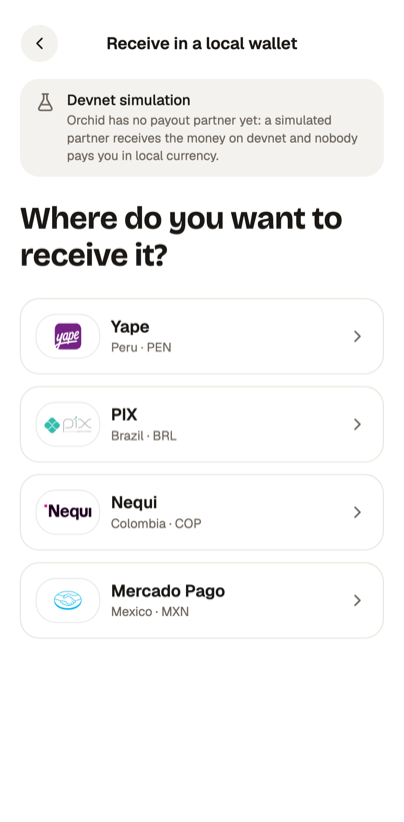
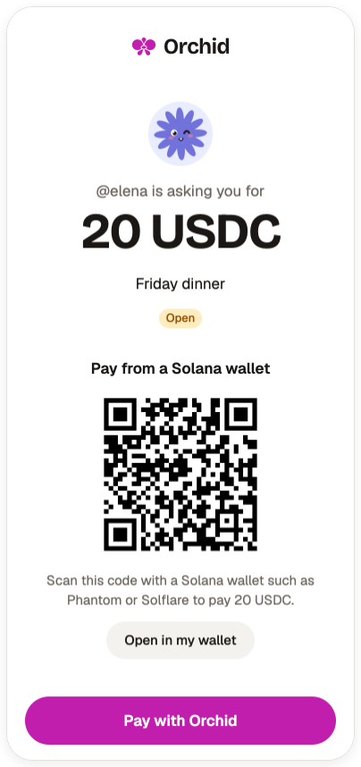
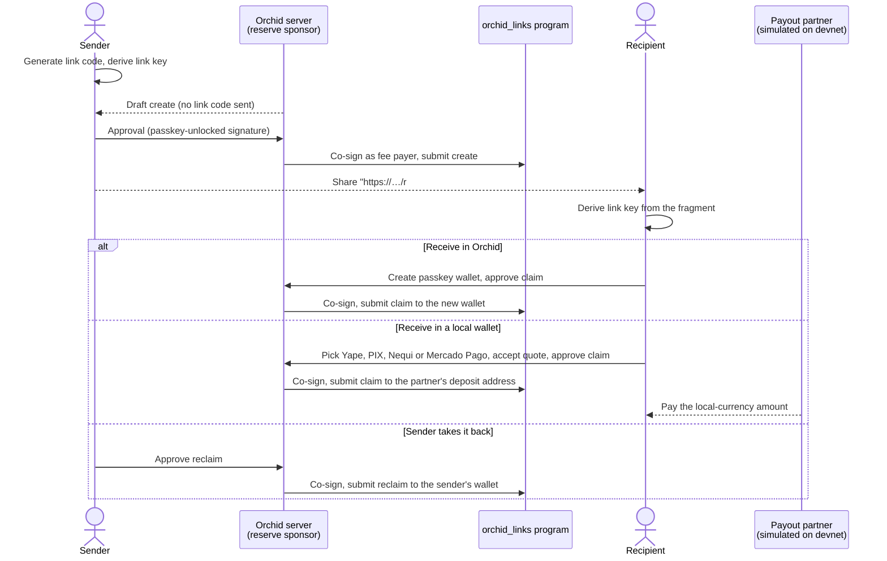

<p align="center">
  <picture>
    <source media="(prefers-color-scheme: dark)" srcset="docs/assets/orchid-logo-dark.png" />
    
  </picture>
</p>

<h3 align="center">Dollars that move by link.</h3>

<p align="center">
  Self-custodial USDC wallet on Solana devnet for Latin America, starting in Peru.<br />
  Built for the dev3pack Solana hackathon · English &amp; Spanish
</p>

<p align="center">
  <a href="https://orchid-pay-devnet.getorchid.workers.dev"></a>
</p>

<p align="center">
  <sub>Devnet program <code>orchid_links</code>: <a href="https://explorer.solana.com/address/GAgsxe3vwNSSFcsaMViggfk37wBaj7yioYaXFYa7Cv6M?cluster=devnet"><code>GAgsxe3vwNSSFcsaMViggfk37wBaj7yioYaXFYa7Cv6M</code></a></sub>
</p>

<p align="center">
  
</p>

## The Problem

Roughly 4 in 10 adults in Peru have no account at a bank or mobile-money provider: account ownership was 59.3% in 2024 ([World Bank Global Findex](https://data.worldbank.org/indicator/FX.OWN.TOTL.ZS?locations=PE)). At the same time, Latin America and the Caribbean received $170 billion in personal remittances in 2025 ([World Bank](https://data.worldbank.org/indicator/BX.TRF.PWKR.CD.DT?locations=ZJ)). Stablecoins could carry that money cheaply, but the bottleneck is the first payment: before receiving a single dollar, a newcomer must install a wallet, guard a secret phrase, share an address and hold SOL for fees.

## Our Solution

Orchid lets anyone send USDC as a link in a chat message. The person who opens it needs nothing in advance: two taps create a self-custodial wallet secured by a passkey, with fees and rent paid by Orchid. If they would rather have local money, the same link pays out to the local wallet they already use, such as Yape in Peru. Every payment becomes a way in for a new user.

## Key Features

- **Payment links that onboard.** The `orchid-links` Anchor program holds the unclaimed funds on Solana, and the link code stays in the URL `#fragment`, so the server never sees it. A recipient with no wallet claims straight into a new passkey wallet in two taps, with network fees and token-account rent sponsored. The sender can take the money back at any time; whichever of claim or reclaim lands first wins.
- **Receive in a local wallet.** On the same link, the recipient taps **Local wallet**, picks Yape (Peru), PIX (Brazil), Nequi (Colombia) or Mercado Pago (Mexico), enters a phone number, PIX key or email, reviews the local-currency quote and follows the payout to completion. _On devnet a simulated payout partner receives the funds and nobody is paid; live payouts need a licensed partner._
- **Payment requests payable from any Solana wallet.** Share a public `/pay/<id>` link for an exact USDC amount and an optional note. Payers settle in Orchid, or from Phantom, Solflare or any other Solana wallet through Solana Pay and Blinks, paying their own network fee.

<table>
  <tr>
    <td align="center" width="33%">
      
      <br />
      <sub><strong>Payment link</strong></sub>
    </td>
    <td align="center" width="33%">
      
      <br />
      <sub><strong>Local wallet payout (simulated)</strong></sub>
    </td>
    <td align="center" width="33%">
      
      <br />
      <sub><strong>Payment request</strong></sub>
    </td>
  </tr>
</table>

## How It Works



- **Self-custody:** each wallet's signing key derives from a secret phrase that stays on the device. Orchid stores only a backup encrypted with the passkey's PRF output, so only that passkey can restore it.
- **Sponsorship:** Orchid's reserve sponsor is the fee payer of every transaction it drafts for its wallets and pays the rent of each wallet's USDC account. Users never need SOL.
- **Settlement:** the server reads finalized results from the chain and tells an expired transaction apart from one a lagging or pruned RPC node cannot see yet.

## Tech Stack

| Layer    | Technologies                                                                     |
| -------- | -------------------------------------------------------------------------------- |
| On-chain | Solana, SPL Token (USDC), Anchor program `orchid-links`, Codama-generated client |
| Payments | Solana Pay, Blinks                                                               |
| Identity | WebAuthn passkeys with the PRF extension                                         |
| App      | TanStack Start, React, Tailwind CSS, Paraglide (English and Spanish)             |
| Backend  | Effect, Drizzle, Postgres, Cloudflare Workers, Hyperdrive, Queues                |
| Tooling  | Bun, Turborepo, Oxlint, Vitest, Playwright, Surfpool                             |

## Quickstart

Prerequisites: Bun, Node.js 22.12+, Docker running, and a Solana devnet RPC URL for the setup prompt (or `SOLANA_RPC_URL` set beforehand).

1. **Set up:** `bun run setup`
2. **Run:** `bun run dev`
3. **Open:** [localhost:3000](http://localhost:3000)

Setup installs dependencies, starts the local Postgres container `orchid-postgres` on port `55432`, applies migrations and configures the gitignored `apps/web/.dev.vars`. It is safe to rerun: it keeps existing values and reuses the main checkout's config in a worktree.

Setup also creates a devnet sponsor if needed and attempts a SOL airdrop. If the airdrop fails, fund the printed public sponsor address at the [Solana faucet](https://faucet.solana.com) and rerun setup to open the simulated payout partner's USDC token account.

### Browser tests

With Docker, Surfpool and the Anchor toolchain installed:

```sh
bun run setup --e2e
anchor build --no-idl --ignore-keys
bun run --cwd apps/web test:e2e
```

Playwright runs against Chromium with a virtual passkey authenticator, a local Surfnet and a disposable Postgres container.

## Challenges and Accomplishments

- **Switched chains mid-build.** Orchid started on another network. We first pulled every chain-specific detail behind one chain binding, then rebuilt addresses, signing, the `orchid-links` program, settlement and deposit reads for Solana, one tracked issue at a time.
- **The link code never reaches the server.** The link code lives only in the URL fragment and on the devices. Browser tests assert that no request and no stored value ever contains it.
- **Passkeys inside chat apps.** The in-app browsers of WhatsApp, Instagram and TikTok cannot evaluate a passkey's PRF, which is exactly where links get opened. Orchid detects them and hands the user off to their own browser before any passkey prompt.
- **Honest settlement on Solana.** Deciding that a transaction expired is unsafe when an RPC node lags or has pruned history. Settlement only reports expiry when the node has caught up and still holds the history from when the transaction was drafted.
- **Deposits from anywhere.** USDC sent from an exchange or another wallet is read per wallet from the history of its USDC account, with a cursor per wallet and a 64-bit ledger.
- **Real end-to-end coverage.** The Anchor program, its Codama client and the whole app run together in Playwright tests on a local Surfnet, including passkey enrollment and claiming a link.

## What is Next

- [x] Passkey wallets with sponsored fees and rent on Solana devnet
- [x] Payment links backed by the `orchid-links` program, with reclaim at any time
- [x] Payment requests payable through Solana Pay and Blinks
- [x] Local wallet payouts through a simulated payout partner
- [ ] A licensed payout partner, so local wallet payouts pay real money
- [ ] Security review of the `orchid-links` program
- [ ] Mainnet launch in Peru

## The Team

| Name             | Role                 | GitHub                                 | LinkedIn                 |
| ---------------- | -------------------- | -------------------------------------- | ------------------------ |
| Marcelo Vizcarra | `<ROLE_PLACEHOLDER>` | [@mavix21](https://github.com/mavix21) | `<LINKEDIN_PLACEHOLDER>` |

More at [mavix.dev](https://mavix.dev). Licensed under the [Apache License 2.0](LICENSE).
